# AVA Marble

[](https://github.com/Harlock123/AVAMarble/actions/workflows/build.yml)

A marble-rolling race against the clock in the style of Atari's 1984 arcade game **Marble Madness**,
built with .NET 10 and Avalonia UI. Guide a glass marble down six courses floating in space, seen
from above at an angle: down ramps, along narrow walkways and over drops to the goal. Fall off the
edge or drop too far and you lose time; run out of time and it's over. Steelies, gulpers, acid and
waves stand in your way.

## Features

- **Real rolling**:
  - **Its course:** made of tiles with a height at each corner, so it has flats, ramps, ledges and drops.
  - **The marble:** speeds up downhill and slows climbing, bounces off walls, and hops down small ledges.
  - **Its fate:** a drop of more than three tiles breaks it; roll off the edge and it falls away into the void.
  - **Brake:** hold the button to bring it under control.
- **Six courses**, each with its own colours and character:
  - **Warm-Up Run:** wide ramps to learn on.
  - **The Nursery Slopes:** narrower paths, little steps down, and a steelie.
  - **Acid Flats:** a plaza with pools of acid, a gulper on patrol, and a floor of rolling waves.
  - **The Sky Walk:** two-tile catwalks high in the air, a big drop, and two steelies.
  - **Topsy Hill:** a steep dive that has to carry you up and over a hill, and two gulpers.
  - **The Gauntlet:** everything at once.
- **The opposition**:
  - **Steelies:** heavy black marbles that hunt you on their own level and knock you about, sometimes off the edge. They can fall off too.
  - **Gulpers:** green coils that hop to and fro and swallow you whole.
  - **Acid:** dissolves the marble.
  - **Waves:** floors that ripple, rising and falling under you.
- **The clock**: each course has its time, and whatever's left carries over to the next. A lost marble comes back on the last safe ground it rolled over, but the clock keeps running while it does.
- **Scoring**: 1,000 points times the course number at each goal, plus 100 for every second left. Finishing all six is worth 10,000 more.
- **Sound**: an original floating waltz in D minor, and sounds for bumps, landings, the long fall, breaking glass, acid fizz, the gulp, the clack of a steelie, the countdown and the last ten seconds. All mixed by OpenAL.
- **Attract mode**: leave the title alone for 15 seconds and a computer marble rolls a course. It:
  - follows the racing line at the speed each stretch allows
  - brakes for corners
  - waits for gulpers to pass
- **A top-ten high-score table** with arcade-style initials entry; it records the course reached.
- **Gamepads** through SDL2, as well as the keyboard.
- **Any window size**: the screen scales to fit, letterboxed. **Ctrl+S** saves a screenshot.
- **One self-contained executable** per platform: Windows, macOS and Linux on Intel/AMD and ARM.

## Screenshots

| The title | Course one | Warm-Up Run |
|:---------:|:----------:|:-----------:|
| 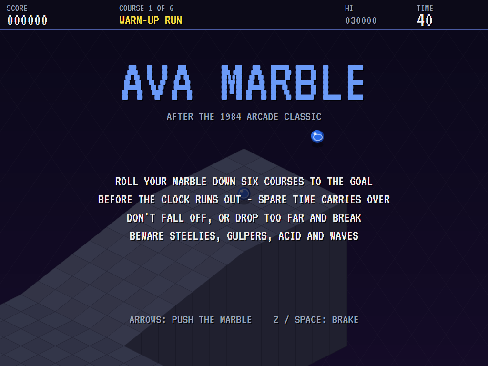 | 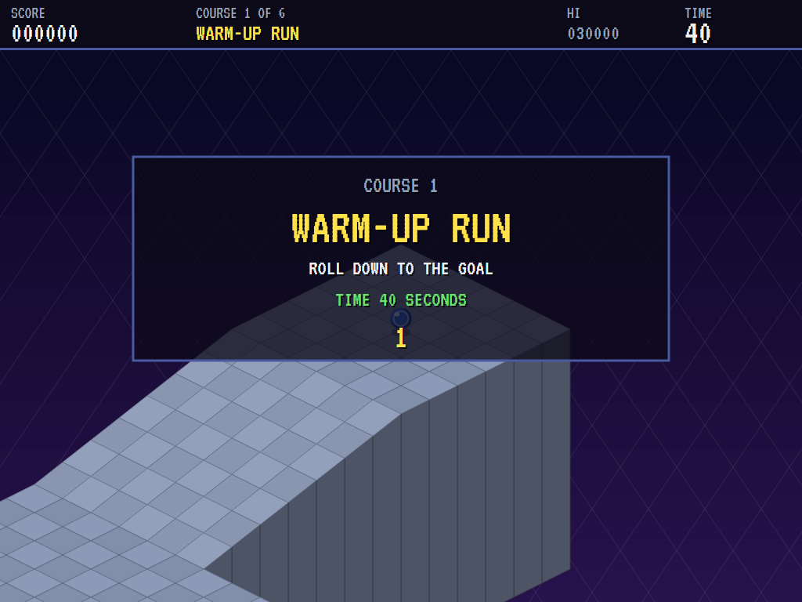 | 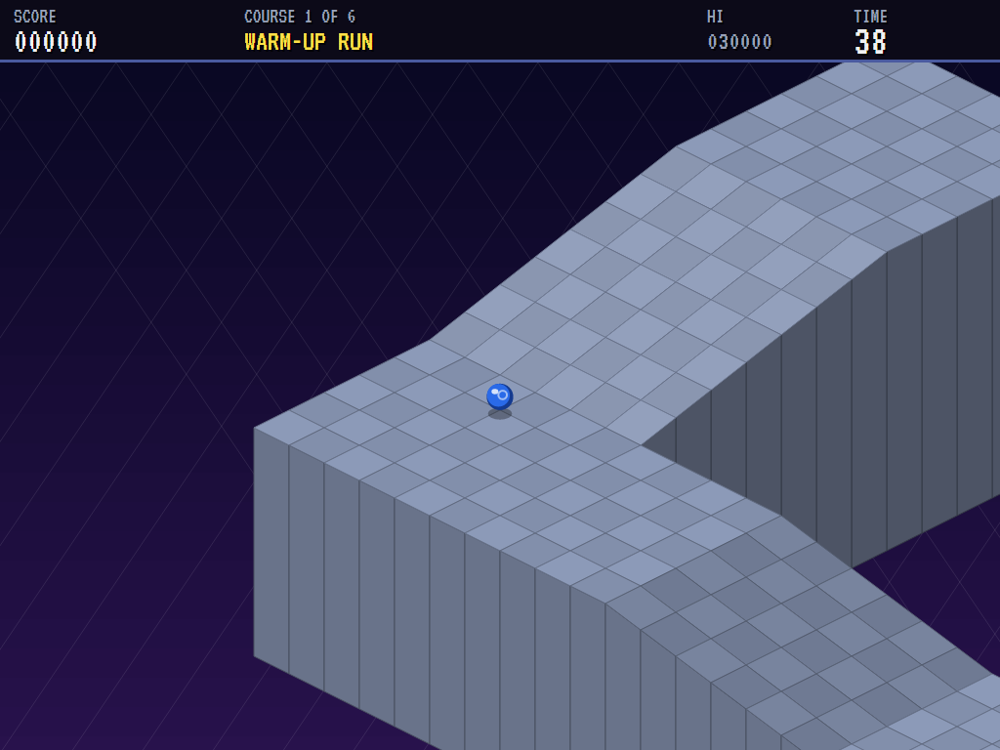 |
| Six courses against the clock. | The count down. | Down the first ramp. |

| A steelie | Acid Flats | Waves |
|:---------:|:----------:|:-----:|
| 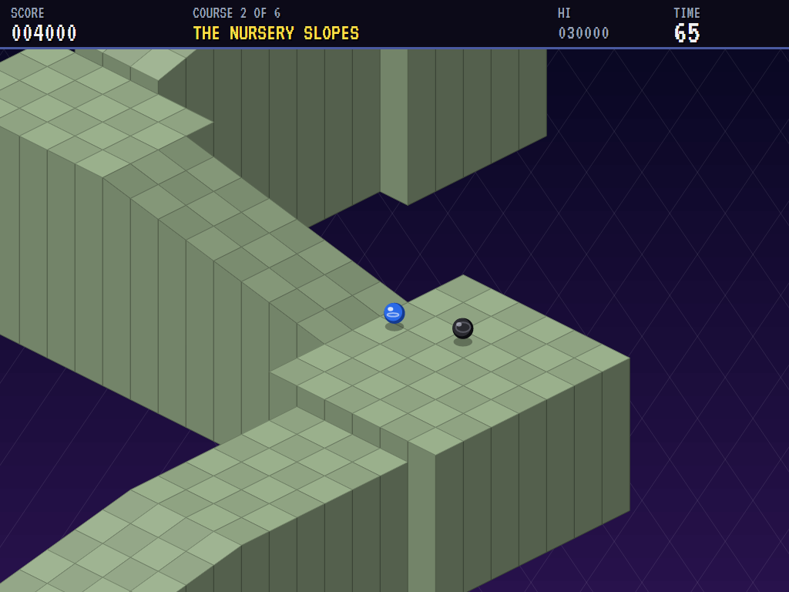 | 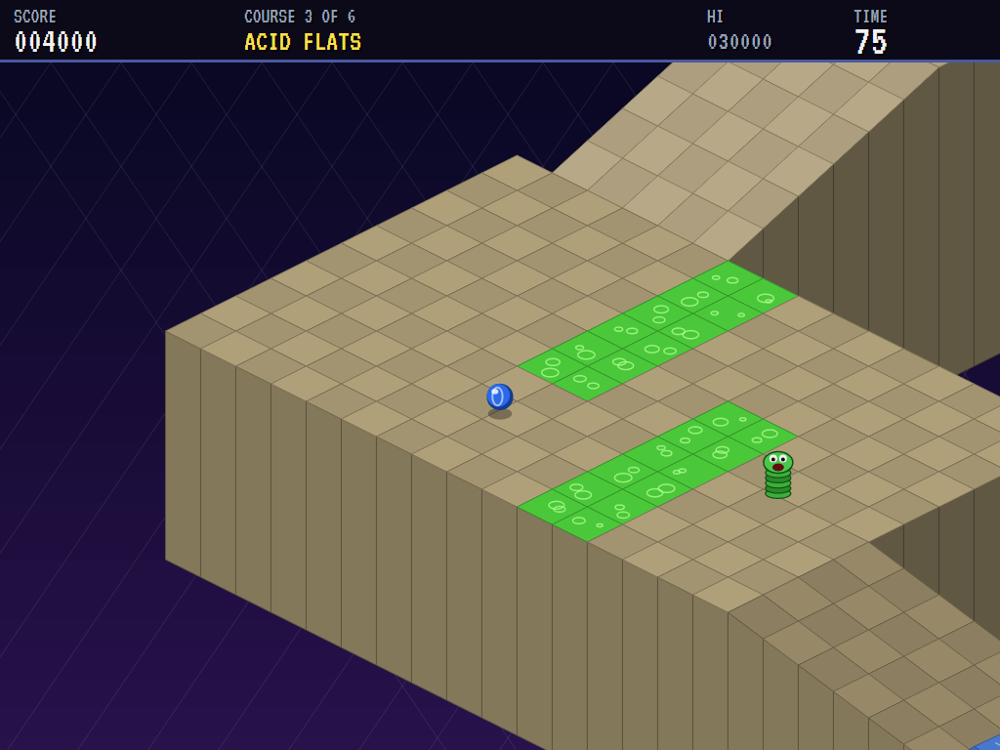 | 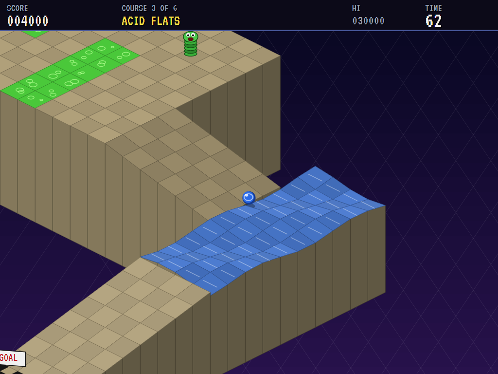 |
| The Nursery Slopes, and a steelie closing in. | Weaving between the acid pools, a gulper waiting. | The floor ripples. |

| The Sky Walk | Topsy Hill | The Gauntlet |
|:------------:|:----------:|:------------:|
| 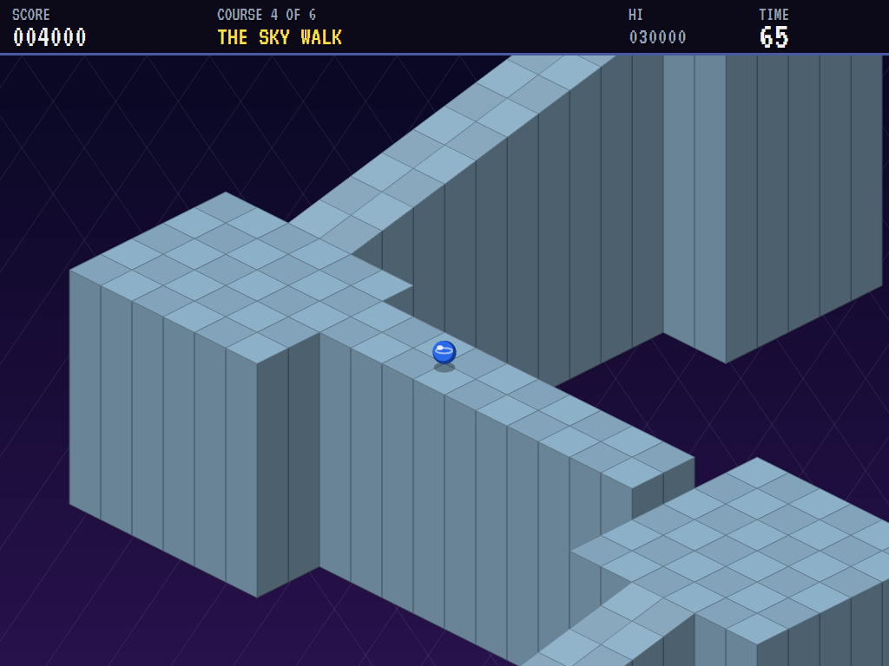 | 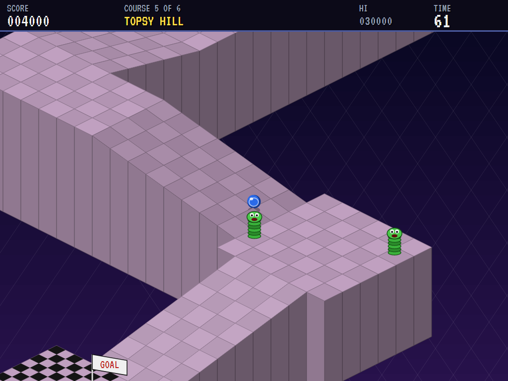 | 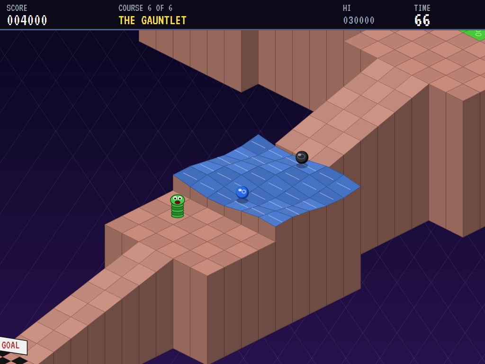 |
| A two-tile catwalk, high up. | Gulpers by the way down to the goal. | Waves, a steelie and a gulper. |

| Over the edge | Finished | The best rollers |
|:-------------:|:--------:|:----------------:|
| 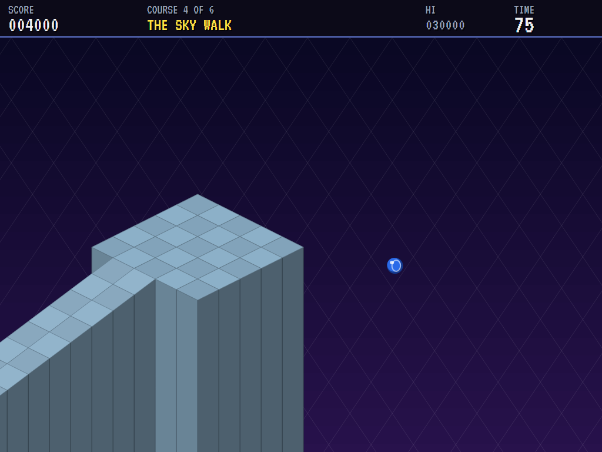 | 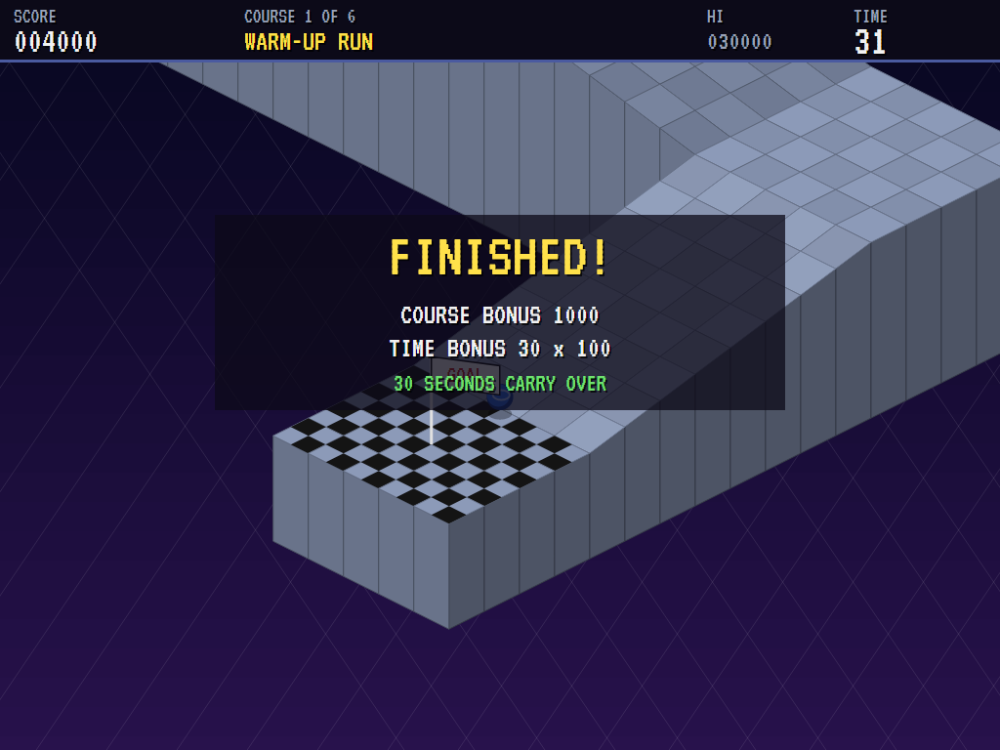 | 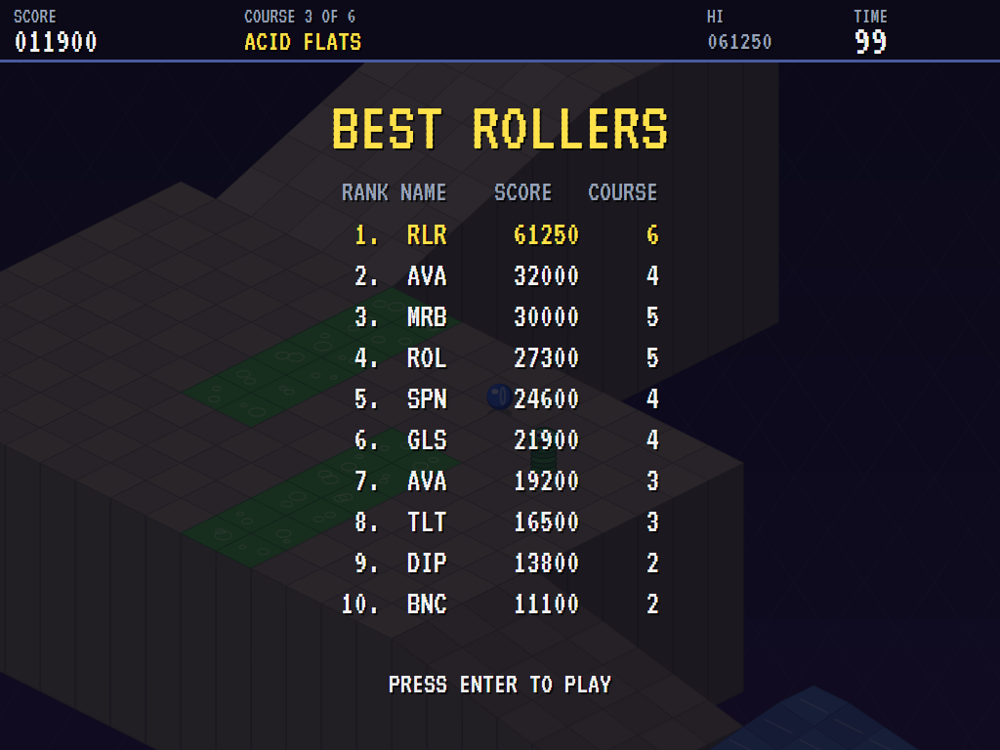 |
| Gone. | The time bonus, and the time carried over. | The high-score table. |

The screenshots are made by the tests, which play the game in a real (headless) window; see
[Tests](#tests).

## Download and run

Ready-to-run builds for Windows, macOS and Linux, on both Intel/AMD and ARM, are on the
[Releases page](https://github.com/Harlock123/AVAMarble/releases/tag/latest). **Latest build** is
rebuilt on every push to `main`. Each download is one self-contained executable: no .NET install is
needed.

| Platform | Archive |
|---|---|
| Windows | `AVAMarble-win-x64.zip`, `AVAMarble-win-x86.zip`, `AVAMarble-win-arm64.zip` |
| macOS | `AVAMarble-osx-arm64.tar.gz` (Apple silicon), `AVAMarble-osx-x64.tar.gz` (Intel) |
| Linux | `AVAMarble-linux-x64.tar.gz`, `AVAMarble-linux-arm64.tar.gz`, `AVAMarble-linux-arm.tar.gz` |

```bash
tar -xzf AVAMarble-linux-x64.tar.gz     # or linux-arm64, linux-arm, osx-arm64, osx-x64
./AVAMarble
```

On Windows, unzip and run `AVAMarble.exe`. On macOS, if Gatekeeper refuses to open it, run
`xattr -d com.apple.quarantine AVAMarble` once. Run with `--no-audio` for silence.

**Sound** comes through OpenAL Soft, built in for every platform. In a virtual machine the game
detects it and uses a larger audio buffer, so the sound doesn't break up.

**Gamepads** use SDL2, which is bundled for Windows, macOS and Intel/AMD Linux. ARM Linux builds need it
installed; without it the keyboard still works:

```bash
sudo apt install libsdl2-dev            # Debian / Ubuntu / Raspberry Pi OS
sudo pacman -S --needed sdl2-compat     # Arch / Omarchy
```

## Controls

| Input | Action |
|-------|--------|
| **Enter** / **Space** | Start |
| **Arrows** (or **W** **A** **S** **D**) | Push the marble that way across the screen; two at once push diagonally |
| **Z** / **X** / **Space** / **Ctrl** (hold) | Brake |
| **P** / **Esc** | Pause (Esc again to quit) |
| **M** | Mute |
| **Ctrl+S** / **Cmd+S** | Save a screenshot to the Pictures folder |

**Gamepad**: left stick or D-pad to push, **A** or **B** to brake, **Start** to start and pause,
**Back** (while paused) to quit.

**Entering initials**: type letters, or dial with **Up**/**Down** and accept with **Space**; **Left** /
**Backspace** go back; **Enter** finishes.

## Tests

```bash
dotnet test AVAMarble.slnx
```

The engine has no UI and runs in fixed 60 Hz steps, so it plays the same at any frame rate, and a seed
always plays the same game. The tests check, mostly on little courses built for the purpose:

- **Rolling:**
  - staying put on the flat, pushing, slowing and braking
  - rolling downhill on its own, bouncing off walls
  - hopping small drops and breaking on big ones
  - falling off the edge and coming back on safe ground while the clock runs
- **Hazards:** acid, waves, a steelie hunting and hitting the marble, and a gulper swallowing it.
- **The clock and the courses:**
  - the goal's points and the time carried over, and time running out
  - the count down holding everything
  - every course starting on solid ground, its racing line over the floor, and ending in a goal
  - the computer marble finishing every course in time, and winning the game
- **The machine:** the attract mode, initials, the same game from the same seed, and the high-score file.

The screenshot tests draw the real screen in a headless window. To refresh the README's pictures:

```bash
MARBLE_SHOTS=$PWD/Images dotnet test tests/AVAMarble.Tests --filter ScreenshotTests
```

To see how the computer marble gets on, course by course (for tuning):

```bash
MARBLE_PROBE=1 dotnet test tests/AVAMarble.Tests --filter MarbleProbe --logger "console;verbosity=detailed"
```

## Building

```bash
dotnet build AVAMarble.slnx
dotnet run --project src/AVAMarble
```

Needs the .NET 10 SDK. The sounds are made by `tools/make_sounds.py` (standard-library Python):
`python3 tools/make_sounds.py` rewrites `src/AVAMarble/Sounds`.

## Project structure

```
AVAMarble/
├── AVAMarble.slnx
├── src/AVAMarble/
│   ├── Engine/
│   │   ├── GameEngine.cs        # States, the title and demo cycle, and the music
│   │   ├── GameEngine.Play.cs   # Rolling, walls, ledges and falls; steelies and gulpers; the
│   │   │                        # clock, the goal and the time carried over
│   │   ├── Course.cs            # Tiles with corner heights, the course builder, and the six courses
│   │   ├── MarblePilot.cs       # The computer's marble, for the demonstration (and the tests)
│   │   ├── Entities.cs
│   │   ├── HighScoreTable.cs, InitialsEntry.cs
│   │   ├── InputHandler.cs, ControllerManager.cs  # Keys and an SDL2 gamepad
│   │   └── SoundManager.cs      # Effects, the rolling music and the tunes through OpenAL
│   ├── Audio/                   # The OpenAL engine (from the author's AVABand)
│   ├── Views/                   # The courses in projection, marbles, gulpers and the screens
│   └── Sounds/                  # The synthesised effects and tunes
├── tests/AVAMarble.Tests/       # Gameplay, screenshot and probe tests
├── tools/make_sounds.py
└── Images/                      # Screenshots
```

## About and licence

AVA Marble © 2026 Lonnie Watson, under the [MIT License](LICENSE).

*Marble Madness* © 1984 Atari Games; the name belongs to its current owner. AVA Marble is an
independent, unofficial game in its style. Its courses, creatures, graphics, sounds, tunes and code
are its own; nothing is taken from the arcade machine's program, graphics, sound or music. It is not
affiliated with or endorsed by any rights holder.
